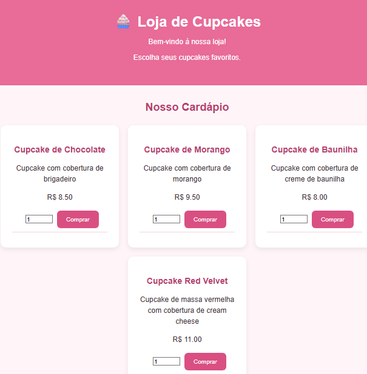
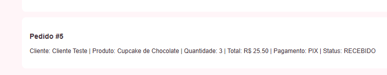
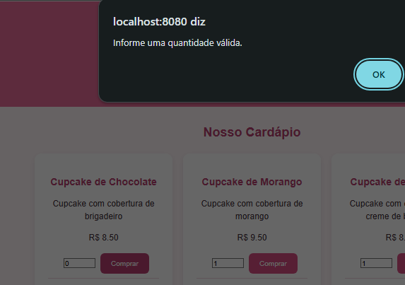
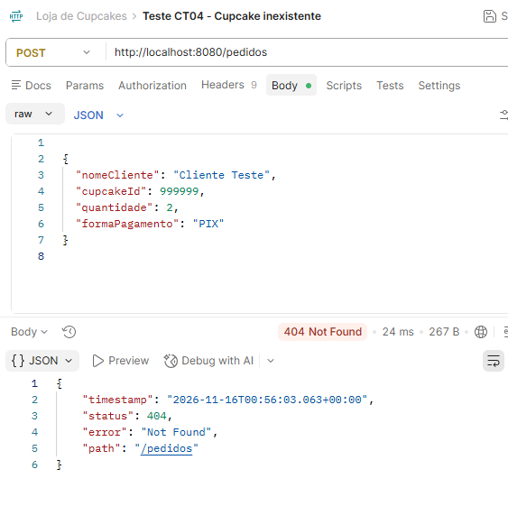
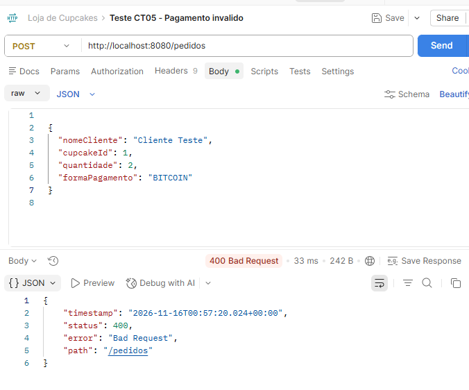

# Plano de Testes Funcionais — Loja de Cupcakes

## 1. Objetivo

Verificar o funcionamento das principais
funcionalidades do sistema Loja de Cupcakes.

## 2. Ambiente de testes

- Java 21
- Spring Boot 3.5.7
- MySQL
- Navegador web
- Postman

## 3. Casos de teste

### CT01 — Consultar cupcakes

Procedimento:
Acessar a página inicial da loja.

Resultado esperado:
Os cupcakes disponíveis são apresentados.

Resultado obtido:
APROVADO — Os quatro cupcakes foram exibidos
corretamente, com seus respectivos nomes e preços.

### CT02 — Realizar pedido válido

Procedimento:
Selecionar um cupcake, informar quantidade,
nome do cliente e forma de pagamento.

Resultado esperado:
Pedido registrado e confirmação apresentada.

Resultado obtido:
APROVADO — Foi realizado um pedido com os seguintes dados:

Cliente: Cliente Teste
Cupcake: Chocolate
Quantidade: 3
Forma de pagamento: PIX

O sistema confirmou o pedido e apresentou
corretamente o valor total de R$ 25,50.

O resultado corresponde ao comportamento esperado.

### CT03 — Validar quantidade inválida

Procedimento:
Tentar realizar um pedido com quantidade zero.

Resultado esperado:
O sistema rejeita o pedido.

Resultado obtido:
APROVADO — Foi realizado um teste utilizando
quantidade zero.

O sistema impediu a confirmação do pedido
e apresentou uma mensagem de validação.

O comportamento corresponde ao resultado esperado.

### CT04 — Validar cupcake inexistente

Procedimento:
Enviar pelo Postman um pedido contendo
um identificador de cupcake inexistente.

Resultado esperado:
O sistema rejeita o pedido.

Resultado obtido:
APROVADO — Foi enviada uma requisição POST
para /pedidos utilizando cupcakeId 999999.

O sistema retornou HTTP 404 (Not Found),
rejeitando a requisição conforme esperado.

### CT05 — Validar forma de pagamento

Procedimento:
Enviar um pedido com uma forma de pagamento
diferente das permitidas.

Resultado esperado:
O sistema rejeita o pedido.

Resultado obtido:
APROVADO — Foi enviada uma requisição POST
para /pedidos utilizando a forma de pagamento
BITCOIN, não permitida pelo sistema.

O sistema retornou HTTP 400 (Bad Request),
rejeitando a requisição conforme esperado.
### CT06 — Consultar pedidos

Procedimento:
Acessar http://localhost:8080/admin.html

Resultado esperado:
Os pedidos registrados são apresentados.

Resultado obtido:
APROVADO — A página administrativa foi acessada
com sucesso e apresentou o pedido realizado.

Cliente: Cliente Teste
Cupcake: Chocolate
Quantidade: 3
Valor total: R$ 25,50
Forma de pagamento: PIX
Status: RECEBIDO

Os dados apresentados correspondem ao pedido
registrado anteriormente.

## 4. Critérios de aprovação

Um teste será considerado aprovado quando
o resultado obtido corresponder ao esperado.

Em caso de falha, registrar o comportamento
observado e as correções necessárias.

## 5. Evidências

## 5. Evidências

As evidências dos testes funcionais estão armazenadas
na pasta `documentacao/evidencias`.

### CT01 — Consultar cupcakes

### CT02 e CT06 — Pedido e consulta administrativa

### CT03 — Quantidade inválida

### CT04 — Cupcake inexistente

### CT05 — Pagamento inválido

## 6. Observações

Este documento registra os testes funcionais
do sistema e deverá ser complementado com
os resultados reais de execução.

As avaliações realizadas por colegas ou
profissionais serão documentadas separadamente.
